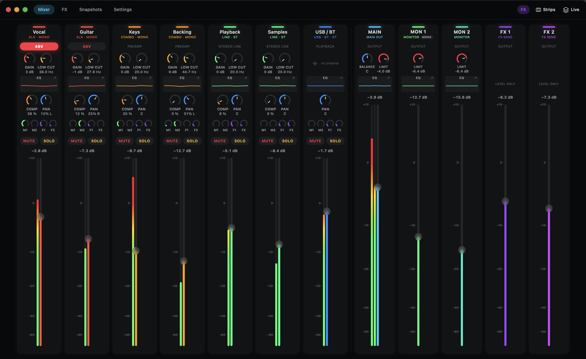

# FLOW8

**Site:** [repentov-dev.github.io/FLOW8](https://repentov-dev.github.io/FLOW8/) · **Download:** [Releases](https://github.com/repentov-dev/FLOW8/releases/latest)



A native macOS app that controls the **Behringer FLOW 8** digital mixer and reads its state
**over Bluetooth LE only**, without MIDI or USB. The interface: compact strips, a dark panel,
nothing extra.

- macOS 14 Sonoma or later
- Apple Silicon (an Intel build is possible)
- No full Xcode needed, Command Line Tools are enough

## Features

**Mixer**

- 7 input strips: Ch 1–4, Ch 5/6, Ch 7/8 and USB / BT
- fader, pan/balance, gain, low cut, compressor, four-band EQ
- 4 sends: Mon 1, Mon 2, FX 1, FX 2
- mute / solo, +48 V phantom power (Ch 1–2)
- 5 buses: Main, Mon 1, Mon 2, FX 1, FX 2, with level, limiter, balance (Main) and
  nine-band EQ (Main / Mon 1 / Mon 2)
- channel and Main (L/R) meters with a calibrated dB scale
- hide unused strips (Strips menu, strip context menu or Settings)
- the FX button in the header shows and hides the FX 1 / FX 2 channels in the mixer
- the window size is remembered and shrinks to two strips; on a narrow window the
  header tabs switch to icons

**Equalizer**

- a mini EQ curve on every strip; press EQ to open a separate window
- in the window: a graph with draggable points and four knobs for fine control
- reset a band by double-clicking a point or with the Reset button

**FX**

- two slots, 16 presets each with real names (Ambience, Delay 1/1, Ping Pong...)
- preset parameter and Character switch
- FX bus level and all channel sends on the FX page
- global FX mute and tap tempo

**Snapshots**

- 15 slots, one-click recall, mixer reset
- snapshot names are read from the mixer over Bluetooth

**Sync**

- the app requests a state dump (`0x38`) and parses faders, EQs, sends, mute/solo, +48 V,
  limiters and FX presets
- continuous sync at a configurable rate plus manual refresh
- knob and fader moves on the mixer itself are picked up live

## Build

You only need Command Line Tools (`xcode-select --install`) and Swift 6.

```bash
./build.sh            # build build/FLOW8.app
./build.sh --run      # build and launch
./build.sh --install  # build, copy to /Applications and launch
```

On first launch macOS asks for Bluetooth permission. It is needed both to control the mixer
and to read its state.

The app is ad-hoc signed (without a Developer ID), so on another Mac macOS may ask you to
confirm the launch: System Settings, Privacy & Security, Open Anyway.

## Controls

| Control | Action |
|---|---|
| Fader | drag up/down (1:1 with the cursor), Shift for fine control, double-click for 0 dB |
| Knob | drag up/down, Shift for fine control, double-click to reset |
| Strip | right-click to hide the strip or open the equalizer |
| Strips in the header | quickly hide and show channels and buses |

The fader and meter scale is non-linear: -10 dB sits exactly in the middle, 0 dB at three
quarters of the travel, and the scale compresses below -10. The dB values are the mixer's
real gain: the curve was measured with a reference tone on a live FLOW 8, not taken from a
linear formula.

## Limitations

- The mixer sends meter data about 3 times per second. The app smooths it into continuous
  movement (fast attack, soft release), but it cannot get packets more often than the mixer
  sends them.
- Meters and faders are calibrated against a reference signal; absolute accuracy is within
  about 1.5 dB.
- Channel EQ adjustment is gain-only (that is how the FLOW 8 parameter map works). Band
  frequencies are fixed and shown as 80 Hz / 240 Hz / 1 kHz / 6 kHz.

## Protocol

Frames are `[type][0x01][data…][checksum]` over the service characteristic
`0034594A-A8E7-4B1A-A6B1-CD5243059A57`. The parameter map and BLE authentication were
researched in [abelroes/flow-8-midi](https://github.com/abelroes/flow-8-midi) (the app uses
only the Bluetooth part; the MIDI code was removed).

## Structure

```
Sources/
  App/        entry point, window, menus, AppKit string localization
  Models/     mixer state, value conversions, FX catalog
  Services/   Bluetooth LE, calibration tables, state dump parser
  UI/         strips, equalizer, FX, snapshots, settings
Tools/        debugging utilities
docs/         landing page for GitHub Pages
```
